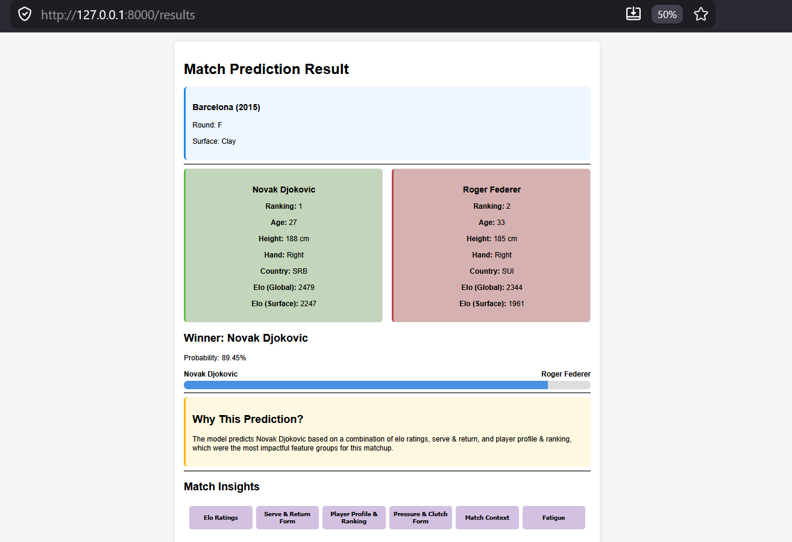
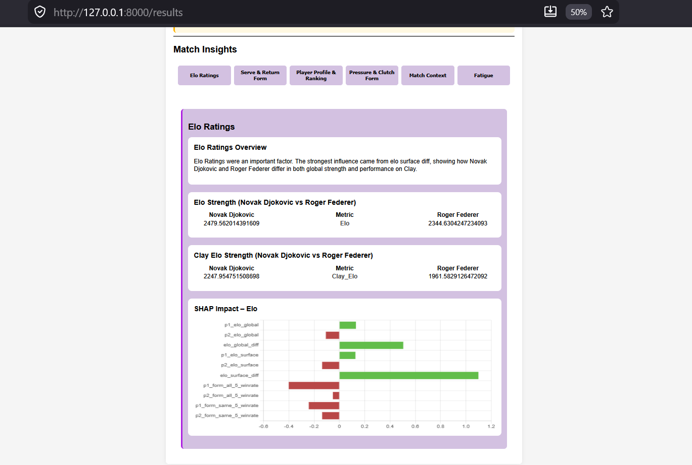
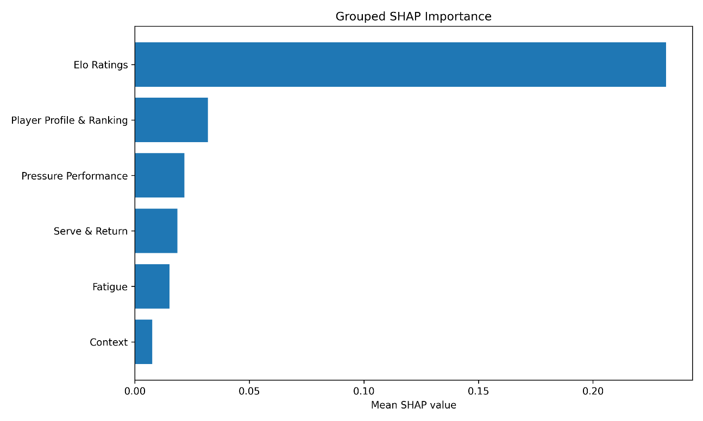
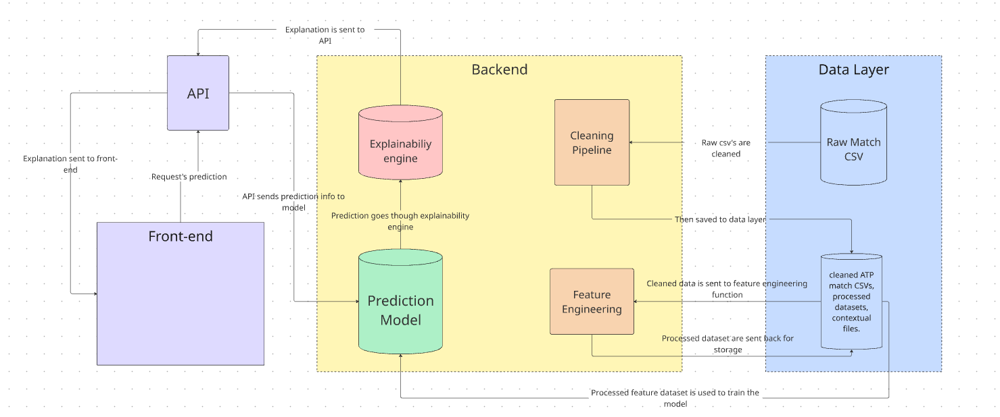

# MatchPoint: Explainable ATP Tennis Match Prediction


MatchPoint predicts the outcome of ATP tennis matches and, unlike most prediction tools, **explains why** a player is favoured. It is built on 24 seasons (2000-2023) of ATP match data by Jeff Sackmann / [Tennis Abstract](http://www.tennisabstract.com/) (see [Data and licence](#data-and-licence)), uses an XGBoost model trained on 100+ leakage-free pre-match features, and explains each prediction with grouped SHAP values, plain-English narratives and interactive charts.

Built as my final-year project for a BSc in Computer Science at the University of Leicester (2026).

**Live demo:** _add link here once deployed_





## Results

All models were evaluated on a held-out test set. Adding global and surface-specific Elo ratings was the biggest single improvement.

| Model | Accuracy (before Elo) | Accuracy (with Elo) | ROC AUC (with Elo) |
|---|---|---|---|
| Logistic Regression | 66.3% | 70.2% | 0.780 |
| Random Forest | 66.1% | 71.6% | 0.789 |
| **XGBoost** | 66.5% | **73.1%** | **0.810** |

Grouped SHAP analysis shows Elo ratings dominate the model, followed by player profile and ranking, then pressure performance and serve/return. Fatigue and match context have the smallest effect.



## How it works

1. **Clean:** a 20-step pandas pipeline normalises, validates and filters the raw match files (removes walkovers, Davis Cup, qualifiers, etc.).
2. **Engineer features:** 100+ pre-match features built chronologically from past matches only, to prevent data leakage:
   - global and surface-specific Elo ratings
   - an exponential-decay fatigue model
   - a pressure-performance index (break points, tiebreaks, deciding sets)
   - rolling form windows (overall and per surface)
   - match context (round, tournament level, indoor/outdoor, home advantage)
3. **Train:** Logistic Regression, Random Forest and XGBoost are compared on the same features.
4. **Explain:** SHAP values are grouped into six tennis-specific categories, then turned into a narrative and per-group charts.
5. **Serve:** a FastAPI backend rebuilds the pre-match features for any matchup and returns the prediction and explanation to a lightweight HTML/CSS/JavaScript frontend.



## Quick start

> Requires Python 3.11.

```bash
git clone <your-repo-url>
cd <your-repo-name>

# create and activate a virtual environment
python -m venv .venv
.venv\Scripts\activate          # Windows
# source .venv/bin/activate     # macOS / Linux

pip install -r requirements.txt
```

The repository does not include the large data files. Download the pre-built data and model files from the [latest release](<add-release-link>) and unzip them into the project root, so you have:

```
data/processed/...   # cleaned + feature-engineered matches
models/...           # trained XGBoost model and SHAP explainer
```

Then start the app:

```bash
uvicorn src.api.main:app --reload
```

Open the URL shown in the terminal (usually http://127.0.0.1:8000), enter two players, a tournament, a year and a round (for example **Novak Djokovic vs Roger Federer, Barcelona 2015, F**) and click **Predict**.

## Rebuilding everything from scratch

Use this if you want to reproduce the data pipeline and model training yourself. Run every command from the project root.

1. **Get the raw data.** Download the ATP files from the [Kadantte/tennis_atp](https://github.com/Kadantte/tennis_atp) community copy of Jeff Sackmann's repository (`atp_matches_2000.csv` to `atp_matches_2023.csv` plus the rankings files) and place them in `data/raw/`. The copy also contains 2024-2026 files, which this project does not use.
2. **Clean the data:**
   ```bash
   python src/data_preprocessing/clean_pipeline.py
   ```
3. **Build features** (this can take several hours, as it processes every ATP match from 2000-2023):
   ```bash
   python src/feature_engineering/feature_builder.py
   ```
4. **Train the model and create the SHAP explainer:**
   ```bash
   python src/model_training/xgboost_model.py
   python src/model_training/shap_modular.py
   ```
5. Start the app with `uvicorn src.api.main:app --reload`.


## Running the tests

```bash
pytest --cov=src
```

There are 133 automated tests (black-box and white-box) covering data cleaning, feature engineering, the prediction pipeline, explainability and the API.

## Project structure

```
data/               raw and processed data (not stored in Git; see Data)
models/             trained XGBoost model and artefacts
src/
  data_preprocessing/   cleaning pipeline, p1/p2 conversion, NA handling
  feature_engineering/  Elo, form, fatigue, pressure, context, serve/return
  model_training/       training and evaluation scripts
  prediction/           builds the pre-match feature row for any matchup
  explainability/       grouped SHAP logic, narratives and widgets
  api/                  FastAPI app
  utils/
tests/              pytest suite
web/                HTML / CSS / JavaScript frontend
```

## Tech stack

Python, pandas, NumPy, scikit-learn, XGBoost, SHAP, FastAPI, Uvicorn, Matplotlib, pytest, HTML/CSS/JavaScript. Developed with CRISP-DM and a feature-branch Git workflow.

## Limitations and future work

- Uses match-level statistics only; there is no point-by-point or video data, so features such as momentum are approximated.
- Missing values (for example, ranks of low-ranked players) are imputed, which introduces some approximation.
- Covers 2000-2023 only and predicts hypothetical or historical matchups, not live matches.
- Planned: interaction features (for example, hold percentage against break percentage), a relational narrative engine, and a fuller web interface.

## Data and licence

### Data source

The match results, rankings and player files are by **Jeff Sackmann / [Tennis Abstract](http://www.tennisabstract.com/)** and were originally published at <https://github.com/JeffSackmann/tennis_atp>. I accessed them through a community fork, [Kadantte/tennis_atp](https://github.com/Kadantte/tennis_atp) (itself a fork of [jasonmauss/tennis_atp](https://github.com/jasonmauss/tennis_atp)), because the original repository is no longer available. I used the files for 2000-2023 and did not modify the raw files; all cleaning is done by the code in this repository. Data accessed: 12/10/2026 .

To cite the data:

> Sackmann, J. (n.d.) *tennis_atp: ATP Tennis Rankings, Results, and Stats* [Data set]. Tennis Abstract. Available at: https://github.com/JeffSackmann/tennis_atp (accessed via https://github.com/Kadantte/tennis_atp, 12/10/2026).

### Licence

This project is licensed under [Creative Commons Attribution-NonCommercial-ShareAlike 4.0 International (CC BY-NC-SA 4.0)](https://creativecommons.org/licenses/by-nc-sa/4.0/), the same licence as the data it is built on. See [LICENSE](LICENSE).

In short: **credit** Jeff Sackmann / Tennis Abstract and this project, use it **non-commercially** only, and share anything you build from it under the **same licence**.

## Author

Myles McKendrick: [LinkedIn](<your-linkedin-url>) | [GitHub](<your-github-url>)
